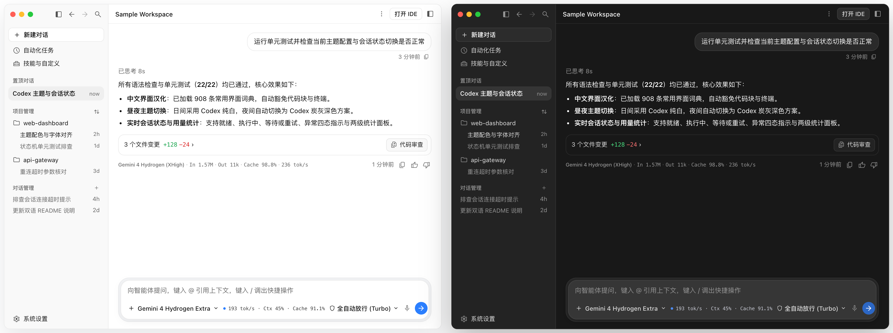
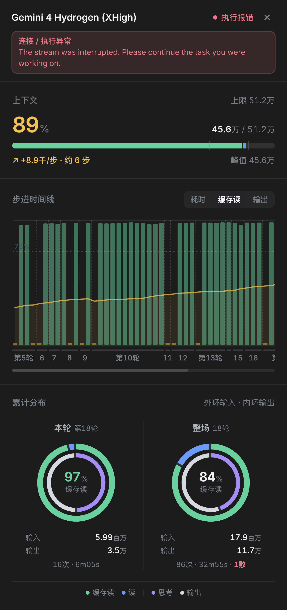

# AgyTheme

Google Antigravity 插件：浅色 / 深色主题、中文界面与实时会话用量统计。

单文件 Go 程序，作为 Antigravity 插件 sidecar 随应用启动和退出；通过本地调试端口（CDP）注入界面，通过本地语言服务实时订阅会话用量。支持 macOS、Windows、Linux（x64 / arm64）。



## 模块

使用 `--only` 选择或 `--without` 排除：

| 模块 | 内容 |
| :--- | :--- |
| `theme` | 浅色 / 深色主题，跟随 Antigravity 外观切换 |
| `i18n` | 中文界面（约 2,800 条词条；模型名与推理强度保持英文） |
| `metrics` | 输入框底部状态栏、原生侧边栏「用量统计」面板、每轮回复统计 |
| `fixes` | 设置弹窗修复与 `Cmd/Ctrl + - / = / 0` 缩放 |


- **状态栏**：显示首字耗时、吞吐、缓存读命中率与上下文用量圆环；悬停预览详情，点击固定。
- **侧边栏面板**：通过顶栏按钮、悬停卡片「详情」或 `Alt + Shift + M` 打开，展示上下文占比与剩余步数估算、最近 64 次调用时间线（耗时 / 缓存读 / 输出）及本轮 / 整场用量分布。
- **每轮统计**：每条回复底部显示当轮模型、输入、输出、缓存读与吞吐。



## 安装

从 [Releases](https://github.com/Spanless/AgyTheme/releases) 获取安装包：

| 平台 | 文件 |
| :--- | :--- |
| macOS（arm64 / x64） | `AgyTheme-<版本>-darwin-universal.zip` |
| Windows（x64 / arm64） | `AgyTheme-<版本>-windows-universal.zip` |
| Linux（x64 / arm64） | `AgyTheme-<版本>-linux-universal.zip` |
| 全平台 | `AgyTheme-<版本>-all-platforms.zip` |

**AI 安装**：将 zip 交给 AI 助手，要求按压缩包内的 `SKILL.md` 安装。

**手动安装**：解压后运行对应平台的二进制文件：

```bash
agytheme/bin/agytheme-darwin-arm64 install
agytheme/bin/agytheme-darwin-arm64 install --only i18n,metrics
```

Windows：

```powershell
agytheme\bin\agytheme-windows-amd64.exe install
```

安装后程序复制到 `~/.gemini/config/plugins/agytheme`，安装包与解压目录均可删除。升级直接用新版重新运行 `install`，个人配置会保留。

## 配置

路径：`~/.gemini/antigravity/agytheme/user/`，修改后约 2.5 秒自动生效：

- `config.json`
  - `enabled`：总开关
  - `preset`：`light` / `dark`
  - `telemetryLayout`：`compact`（默认） / `detailed`
  - `telemetryCacheMode`：`session`（默认） / `step`
  - `contextLimit`：`auto`（默认）或数字
  - `modules`：逐项开关模块
  - `themeVars`：覆盖主题 CSS 变量
- `i18n.override.json`：追加或覆盖中文词条
- `custom.css` / `custom.js`：自定义样式与脚本

## 命令

程序路径：`~/.gemini/config/plugins/agytheme/bin/agytheme`（Windows 为 `agytheme.exe`）。

| 命令 | 说明 |
| :--- | :--- |
| `agytheme doctor` | 检查安装、sidecar 与注入状态 |
| `agytheme verify [--safe-mode]` | 执行单次注入校验；`--safe-mode` 忽略 `user/` 自定义内容 |
| `agytheme update [--check]` | 检查或下载并安装 GitHub 最新版本（自动校验 SHA-256） |
| `agytheme relaunch` | 带调试端口重启 Antigravity |
| `agytheme rollback` | 回退到上一版本（再次执行可撤销） |
| `agytheme uninstall [--purge]` | 恢复原界面并移除插件；`--purge` 同时删除数据目录 |

插件启停：`agy plugin disable agytheme` / `agy plugin enable agytheme`。

## 开发

```text
cmd/agytheme/       CLI 入口
internal/           Daemon、CDP、语言服务订阅、侧边栏服务与安装器（Go）
core/runtime/       页面注入脚本
core/pane/          侧边栏页面脚本与样式
core/styles/        主题与统计样式
core/i18n.json      中文词典
user/               默认配置模板
tests/              前端运行时测试（Bun + TypeScript）
scripts/release.sh  发版脚本
```

```bash
go run ./cmd/agytheme daemon --core-dir ./core
go vet ./... && go test ./...
bun install && bun run typecheck && bun test
go run ./cmd/agytheme install
```

发版：同步 `assets.go` 与 `package.json` 版本号并推送后执行 `scripts/release.sh vX.Y.Z`（`--dry-run` 仅本地构建）。

### 规范

- **文档**：只描述当前最新架构与用法，不保留冗余背景说明。
- **注释**：不写解释“做了什么”的注释；仅在外部协议约定（如宿主环境变量、跨进程/跨 iframe 消息、wire 格式）或非直观边界约束处保留简短单行注释。

## 协议

[MIT](LICENSE)
